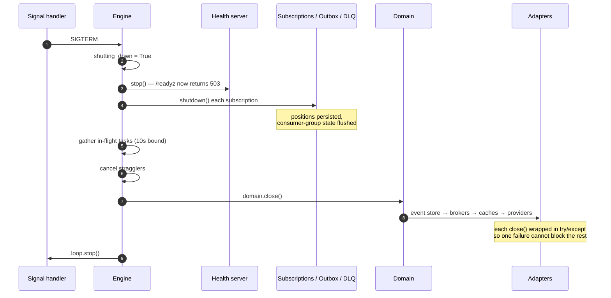

# How the Engine works

The `Engine` class runs Protean's async message processing system. It creates
the subscriptions and passes each message to its handler. It also starts every
component and shuts them down gracefully.

## What the Engine does

The Engine is responsible for:

1. **Registering handler subscriptions**: Creating subscriptions for event
   handlers, command handlers, and projectors
2. **Creating broker subscriptions**: Connecting subscribers to external
   message brokers
3. **Running outbox processors**: Publishing messages from the transactional
   outbox
4. **Coordinating lifecycle**: Starting, running, and gracefully shutting down
   all components
5. **Emitting trace events**: Publishing structured `MessageTrace` events at
   each stage of message processing for real-time observability

## What happens when you create an Engine

When you create an Engine instance, it automatically discovers and registers all
handlers from your domain:

```python
--8<-- "concepts/async-processing/engine/001.py:create"
```

## How the Engine registers subscriptions

The Engine associates subscriptions with each handler during initialization.
The Engine's subscription factory picks the subscription type from the
[configuration hierarchy](#configuration-hierarchy).

### How event handlers and projectors get subscriptions

For each event handler and projector, the Engine creates one subscription per
handler, inferring the stream category and resolving configuration:

1. Infers the stream category from handler metadata or associated aggregate
2. Resolves subscription configuration using the priority hierarchy
3. Initializes the right [Subscription Type](../../reference/server/subscription-types.md), either
a `StreamSubscription` or an `EventStoreSubscription`, for the handler.

```python
--8<-- "concepts/async-processing/engine/001.py:order"
--8<-- "concepts/async-processing/engine/001.py:register"
```

### How command handlers share one subscription

When multiple command handlers belong to the same aggregate (and therefore the
same stream category), the Engine consolidates them into a single subscription
using a `CommandDispatcher`. With one subscription per handler, N separate
subscriptions would compete for the same messages. The dispatcher instead reads
each command once and routes it to the correct handler based on the command
type:

```python
--8<-- "concepts/async-processing/engine/002.py:user"
--8<-- "concepts/async-processing/engine/002.py:handlers"
```

The `CommandDispatcher` caches the deserialized domain object between handler
resolution and execution to avoid double deserialization.

### How subscribers connect to brokers

For external message subscribers, the Engine creates `BrokerSubscription`
instances that connect to the configured message broker:

```python
--8<-- "concepts/async-processing/engine/003.py:subscriber"
```

### How the Engine runs outbox processors

When the outbox is enabled (via `default_subscription_type = "stream"`), the
Engine creates an `OutboxProcessor` for each managed database provider holding
an aggregate. Each `OutboxProcessor` publishes messages to the configured
broker. A provider configured with `managed = false` gets no processor:

```toml
# Configuration in domain.toml
[server]
default_subscription_type = "stream"   # Enables outbox

[outbox]
broker = "default"
messages_per_tick = 10
tick_interval = 1
```

### How the Engine publishes to external brokers

When `external_brokers` is configured, the Engine creates additional
`OutboxProcessor` instances. It creates one per external broker for each
managed database provider holding an aggregate. Each external processor reads
only the outbox rows tagged with its target broker. It publishes those rows
with a stripped metadata envelope suitable for external consumers:

```toml
[outbox]
broker = "default"
external_brokers = ["partner_events"]   # Adds external processors
```

With one database provider, this `[outbox]` configuration creates two
processors:

- `outbox-processor-default-to-default`: Internal events
- `outbox-processor-default-to-partner_events-external`: Published events to
  external broker

External processors emit `outbox.external_published` and
`outbox.external_failed` trace events (distinct from internal
`outbox.published` / `outbox.failed`). They skip priority lane routing, since
lanes are an internal concern.

See [Dispatching Published Events to External Brokers](../../guides/server/external-event-dispatch.md)
for the full setup guide.

## How the Engine resolves subscription configuration { #configuration-hierarchy }

When registering subscriptions, the Engine consults a hierarchy of configuration sources to determine the appropriate subscription type and options for each handler. The resolution process typically follows this order of precedence:

1. **Set on the handler**: Explicit parameters set on the handler, such as
   stream name, broker, or processing options.
2. **Inferred from domain elements**: Values inferred from associated
   aggregate, event, or command definitions.
3. **Taken from the profile or role**: Settings derived from the active
   configuration profile (e.g., "production", "projection") or handler role
   (such as projector vs. handler).
4. **Read from domain or global configuration**: Defaults specified in the
   domain configuration files (`domain.toml` or equivalent).

This means that explicit intent at the handler level takes priority, but system-wide defaults provide sensible behavior when specifics are not set.

For example, if a handler specifies a custom stream name, the Engine uses it.
Otherwise, the Engine infers the stream category from the handler’s associated
aggregate, or falls back to profile or domain defaults.

## How the Engine traces messages

The Engine initializes a `TraceEmitter` at startup. The `TraceEmitter`
publishes structured `MessageTrace` events as messages move through the
pipeline. Trace events are emitted at three points during `handle_message`:

- `handler.started`: Before the handler processes the message
- `handler.completed`: After successful processing (includes `duration_ms`)
- `handler.failed`: When the handler raises an exception (includes `error`)

Additional trace events are emitted by `StreamSubscription` (`message.acked`,
`message.nacked`, `message.dlq`) and `OutboxProcessor` (`outbox.published`,
`outbox.failed`).

### How the emitter writes to two channels

The TraceEmitter writes to two Redis channels:

- **Pub/Sub** (`protean:trace`), Real-time fan-out for SSE clients. The emitter checks
  subscriber count and skips when nobody is listening.
- **Stream** (`protean:traces`), Time-bounded history for the Observatory dashboard and
  REST API. The emitter trims old entries automatically, based on the
  configured retention period.

### How long the stream keeps traces

The Engine reads `trace_retention_days` from the domain's `[observatory]`
configuration (default: 7 days). When set to `0`, Stream persistence is
disabled and only Pub/Sub broadcasting is available. The Engine converts the
value with Python's `int()`, so `3.9` becomes 3 days. A negative number also
disables persistence. If `[observatory]` is missing or not a table, or `int()`
cannot convert the value (such as `"abc"` or `inf`), the Engine falls back to
the 7-day default.

The emitter adds no overhead when no monitoring tools are subscribed and
persistence is disabled. For the full design, the Observatory monitoring
server, and trace API endpoints, see
[Observability](../../reference/server/observability.md).

## How the Engine restores request context

When the Engine processes a message, it restores the cross-cutting context
captured at the message's original creation. This is critical for multi-tenant
applications, user-scoped auditing, and any scenario where async handlers need
ambient context from the original request.

### How it works

1. During the original request, [enrichers](../../patterns/message-enrichment.md)
   inject values from `g` (e.g., `g.tenant_id`, `g.user_id`) into the message's
   `metadata.extensions`.
2. The message is persisted to the event store with its extensions intact.
3. When the Engine picks up the message for async processing, it reads
   `metadata.extensions` and passes them as keyword arguments to
   `domain_context()`:

```python
# fragment
# Simplified from engine.py: what the Engine does for each message
extensions = message.metadata.extensions or {}

with self.domain.domain_context(**extensions):
    g.message_in_context = message
    # Handler runs here — g.tenant_id, g.user_id, etc. are available
```

This means any key injected by an enricher is automatically available as an
attribute on `g` inside the handler. You do not need to extract these keys
manually.

### `g.message_in_context`

In addition to restoring enricher-injected values, the Engine sets
`g.message_in_context` to the current message being processed. Handlers can
use this to access the full message metadata:

```python
--8<-- "concepts/async-processing/engine/001.py:context"
```

After the handler completes (or fails), the Engine tears down the domain
context and cleans up `g`. Extensions from one message are not present on `g`
when the next message runs.

For a complete worked example of context propagation in a multi-tenant
application, see [Multi-Tenancy in Event-Driven Systems](../../patterns/multi-tenancy.md).

---

## How the Engine shuts down

The Engine owns the lifecycle of every infrastructure adapter it opens. When
the Engine receives `SIGINT`, `SIGTERM`, or `SIGHUP`, it runs a deliberate
four-step shutdown sequence. The sequence preserves three invariants:

1. **Load balancers pull the pod out of rotation first**: Readiness probes flip
   to `503` before handlers stop. New traffic therefore stops arriving before
   in-flight work is disturbed.
2. **In-flight handlers finish or are bounded**: Each handler gets up
   to 10 seconds to complete, after which stragglers are cancelled.
   This bounds shutdown time without sacrificing successful commits
   that are already underway.
3. **Resources close in reverse-initialisation order**: Dependents close before
   their dependencies, so a handler mid-commit never finds its repository's
   connection pool already closed.



You get two guarantees from this shutdown sequence:

- **`/readyz` fails before any handler is disturbed**: The health
  server stops in step 3; subscriptions stop in step 4; in-flight handlers
  drain in step 5. A load balancer polling `/readyz` every 5 seconds pulls the
  pod out of rotation within those 5 seconds. Requests already in flight
  complete on the old pod.
- **`Domain.close()` is safe to call from application code**: You can invoke
  `domain.close()` directly from tests and tooling that create domains on
  demand. Each adapter's `close()` is wrapped in `try/except` inside the Domain
  so a misbehaving adapter cannot prevent the rest from closing. Custom
  adapters inherit a no-op `close()`. When your adapter holds sockets, file
  handles, or background threads, override `close()`.

Two pages give the `terminationGracePeriodSeconds` you need in Kubernetes and
the full shutdown reference. These pages also explain what `Domain.close()` does per adapter, when `SIGHUP` vs `SIGTERM` matter, and how to disable the health server. See [Server Hardening reference](../../reference/server/hardening.md#how-does-the-engine-shut-down) and [Harden the Server](../../guides/server/hardening.md#shut-down-gracefully).
The design rationale (why subscriptions stop first, why 10 seconds, why
per-adapter error isolation) is captured in
[ADR-0011](../../adr/0011-engine-shutdown-and-resource-lifecycle-contract.md).

---

## Running the Engine

For comprehensive information on how to start, configure, and operate the engine, including:

- CLI commands and options
- Test mode for deterministic testing
- Debug mode for troubleshooting
- Programmatic usage
- Production deployment strategies
- Signal handling and graceful shutdown
- Monitoring, health checks, and observability

See the [Running the Server](../../guides/server/index.md) guide.

## Where to go next

- [Subscriptions](subscriptions.md): Learn how handlers connect to message sources and react to events.
- [Subscription Types](../../reference/server/subscription-types.md): Compare StreamSubscription and EventStoreSubscription, and choose the right one for your workload.
- [Configuration](../../reference/server/configuration.md): Read the full
  options for configuring engine profiles, subscriptions, and runtime options.
- [Outbox Pattern](outbox.md): Understand reliable message publishing and transactional outbox processing.
- [Observability](../../reference/server/observability.md): Real-time tracing, the Observatory server, SSE streaming, and Prometheus metrics.
- [Running the Server](../../guides/server/index.md): Explore how to deploy, operate, and monitor the server in different environments.
