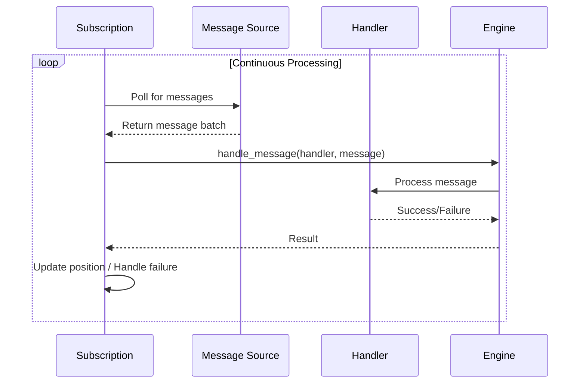

# How subscriptions connect handlers to message sources

Subscriptions are the mechanism that connects handlers to message sources. They
manage the flow of messages from event stores and message brokers to your
handlers, tracking position, handling errors, and ensuring reliable delivery.

## What is a Subscription?

A subscription is a long-running process that:

1. **Polls for messages** from a message source (event store or broker stream)
2. **Delivers messages** to the appropriate handler
3. **Tracks position** so it can resume from the last message it processed
4. **Handles failures** with retries and error callbacks



## Which types of subscription does Protean provide?

Protean provides two types of subscriptions:

### Handler subscriptions deliver messages to your handlers

Handler subscriptions connect **event handlers**, **command handlers**, and
**projectors** to message sources. They can use either:

- **StreamSubscription**: For production workloads using Redis Streams
- **EventStoreSubscription**: For reading directly from the event store

The `SubscriptionFactory` automatically selects the appropriate type based on
configuration.

### Broker subscriptions deliver external messages to subscribers

Broker subscriptions connect **subscribers** to external message brokers. They
are used for consuming messages from systems outside your domain. A subscriber
receives each message's payload in its `__call__` method:

```python
--8<-- "concepts/async-processing/subscriptions/001.py:subscriber"
```

## Subscriptions read from stream categories {#stream-categories}

Subscriptions connect handlers to **[stream categories](./stream-categories.md)**, which are logical groupings of related messages (events and commands). Stream categories determine how messages are organized and routed from message sources (event stores, brokers) to handlers.

### How Subscriptions Use Stream Categories

When you define a handler, it subscribes to a specific stream category:

```python
--8<-- "concepts/async-processing/subscriptions/002.py:handler"
```

The engine creates a subscription that:

1. Polls the stream category for new messages
2. Delivers messages to the handler
3. Tracks the handler's position in the stream
4. Handles errors and retries

### Handlers subscribe to their aggregate's stream category by default

Handlers automatically subscribe to their associated aggregate's stream category:

```python
--8<-- "concepts/async-processing/subscriptions/003.py:default_category"
```

### Subscribe a handler to a different stream category

Handlers can subscribe to a different stream category. A handler on a shared
stream such as `all_orders` usually reads every event on it with
`@handle("$any")`, for a report or an audit log:

```python
--8<-- "concepts/async-processing/subscriptions/002.py:custom_category"
```

### Coordinate a change across aggregates

When an `Order` event must change `Inventory`, the event handler stays with
`Order`. The event handler subscribes to the `order` stream. The event handler
issues a command that is part of `Inventory`. Inventory's command handler then
does the write. In this example, an `Order` raises `OrderShipped` and an
`Inventory` changes through a `ReduceStock` command:

```python
--8<-- "concepts/async-processing/subscriptions/004.py:model"
```

The event handler on `Order` issues the command:

```python
--8<-- "concepts/async-processing/subscriptions/004.py:hand_off"
```

`protean check` reports `EVENT_HANDLER_FOREIGN_EVENT` for an event handler that
is part of `Inventory` but handles `OrderShipped`. `Order` owns the
`OrderShipped` event. The [event handlers
guide](../../guides/consume-state/event-handlers.md#defining-an-event-handler)
shows the full example. In that example, the command handler skips an order
when it has already applied that order.

For comprehensive details on stream categories, including message organization, routing patterns, event sourcing, and best practices, see the [Stream Categories](./stream-categories.md) guide.

## How a subscription runs from start to shutdown

### A subscription prepares its message source when it starts

When a subscription starts, it performs type-specific initialization:

- **StreamSubscription**: Ensures consumer group exists in Redis
- **EventStoreSubscription**: Loads last processed position from event store

### A subscription polls for messages in a loop

Subscriptions run a continuous polling loop:

```python
# fragment
async def poll(self):
    while self.keep_going and not self.engine.shutting_down:
        # Get next batch of messages
        messages = await self.get_next_batch_of_messages()

        if messages:
            # Process the batch
            await self.process_batch(messages)

        # Sleep between ticks (if configured)
        await asyncio.sleep(self.tick_interval)
```

### How a subscription processes each message

For each message in a batch:

1. Deserialize the message
2. Call `engine.handle_message(handler, message)`
3. On success: Acknowledge the message, update position
4. On failure: Retry or move to dead letter queue

### What a subscription does at shutdown

During shutdown, subscriptions:

1. Stop accepting new messages
2. Complete processing of current batch
3. Persist final position
4. Clean up resources

## How subscriptions track their position

Subscriptions track their position to ensure messages are not reprocessed after
restarts.

### EventStoreSubscription Position

EventStoreSubscription stores position in the event store itself:

```python
# fragment
# Position stream name
f"position-{subscriber_name}-{stream_category}"

# Position is stored as a message
{
    "data": {"position": 42},
    "metadata": {"type": "Read", ...}
}
```

Position is updated periodically based on `position_update_interval`.

### StreamSubscription Position

StreamSubscription uses Redis Streams' built-in consumer group tracking:

- Messages are acknowledged after successful processing
- Pending messages are tracked automatically
- Failed messages can be retried or moved to DLQ

## How far behind is a projection?

Each EventStoreSubscription records its position together with the time it
wrote that position. From these two values, Protean can tell how far behind a
projection is. A projection's **staleness** is the time since its projector
last advanced while events remained unprocessed. A projection's **lag** is the
number of events still behind the stream head. A projection fed by several
projectors is as stale as its worst feeder.

Time-based staleness depends on the position-write timestamp. For this reason,
Protean reports time-based staleness for event-store-backed projectors.
Stream-backed (Redis) projectors report lag but not time-based staleness.
Inspect staleness with `protean projection status` or the
`protean_projection_staleness_seconds` metric; see [Monitor the
System](../../guides/server/monitoring.md#monitoring-projection-staleness).

## How subscriptions respond to errors

Subscriptions handle errors at multiple levels:

### A handler raises an exception

When a handler raises an exception:

1. The exception is logged with full context
2. The handler's `handle_error` method is called (if defined)
3. The subscription continues processing

### A subscription retries transient errors

For transient errors (network issues, etc.):

- Exponential backoff between retries
- Configurable maximum retries
- Dead letter queue for persistent failures (StreamSubscription only)

### A fatal error shuts down the engine

For unrecoverable errors:

- The engine's exception handler is triggered
- Graceful shutdown is initiated
- Exit code indicates failure

### Inspect, replay and purge messages in the dead letter queue

When a message exhausts all retries in a `StreamSubscription`, the subscription
moves it to a **Dead Letter Queue (DLQ)**, a separate stream named
`{stream_category}:dlq`. When [priority lanes](./priority-lanes.md) are
enabled, backfill failures go to `{stream_category}:backfill:dlq`.

Each DLQ message keeps the original payload. It also carries metadata: the
failure reason, the number of retries attempted, and the consumer group that
was processing it. Protean provides two interfaces for inspecting and acting on
DLQ messages:

**CLI**, The [`protean dlq`](../../reference/cli/data/dlq.md) commands let you list,
inspect, replay, and purge DLQ messages from the terminal:

```bash
# See all failed messages
protean dlq list --domain=my_app

# Inspect a specific failure
protean dlq inspect <dlq_id> --domain=my_app

# Replay a single message back to its original stream
protean dlq replay <dlq_id> --domain=my_app

# Replay all messages for a subscription
protean dlq replay-all --subscription=order --domain=my_app

# Clear a subscription's DLQ
protean dlq purge --subscription=order --domain=my_app
```

**Observatory**, The [Observatory
dashboard](../../reference/server/observability.md) includes a DLQ tab that
provides the same capabilities through a web interface. Observatory also offers
REST API endpoints at `/api/dlq/*` for programmatic access.


## Where to go next

- [Subscription Types](../../reference/server/subscription-types.md): StreamSubscription in detail
  vs EventStoreSubscription
- [Configuration](../../reference/server/configuration.md): Configure subscriptions with profiles and
  options
