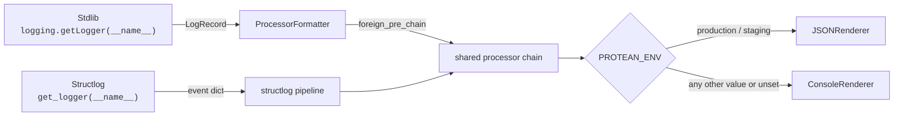

# Logging

Why Protean's logging works the way it does. For task-oriented instructions
see the [Logging guide](../../guides/server/logging.md); for the config keys,
framework loggers, and event schemas, see the
[Logging reference](../../reference/logging.md).

---

## Why structured logs?

The [12-factor](https://12factor.net/logs) approach treats logs as an event
stream and has been common practice for more than a decade. Most codebases
still write human-formatted strings and stop there:

```python
# fragment
# The old way: looks readable, queries like grep
logger.info(f"Refunded ${amount} for order {order_id} because {reason}")
```

When a customer reports a missing refund, you open Loki or Elasticsearch and
search. You don't know whether people wrote `"Refunded"` or `"Refund issued"`
or `"Processing refund"`; you don't know whether the amount comes before or
after the order id; you don't know whether the reason is free text or a code.
To answer any question about the refund, you have to read the text of each
matching log line.

Structured logs invert that:

```python
--8<-- "concepts/observability/logging/001.py:structured"
```

`event=payment_refunded AND reason=customer_request` is a viable query.
`avg(amount) by reason` is a viable aggregation. `count by hour` draws a
time series. Strings are opaque; fields are data.

Protean follows this pattern throughout. Every hot-path event the framework
emits uses a stable name and structured fields. The `get_logger()` API
encourages application code to do the same.

---

## The wide event pattern

Structured logs alone still leave an observability gap. When something goes
wrong inside a handler, you typically have a dozen scattered log lines:
"started processing", "loaded aggregate", "validated input", "raised event",
"saved aggregate", "committed UoW". You then piece together what happened by
filtering on `correlation_id`.

The **wide event pattern** replaces that stream of thin events with one **rich
event per unit of work**. Jamie Brandon's [*Logging Sucks, So Use Wide
Events*](https://loggingsucks.com) made the term widely known. Stripe
engineering wrote down the same pattern on its own as the [canonical log
line](https://brandur.org/canonical-log-lines):

> We emit one log line for every request our application handles. The
> log line contains every field we might want to query on: request id,
> user id, response time, status code, billing plan, A/B test cohorts,
> and so on.

That one log line answers:

- "Which requests failed in the last 10 minutes?"
- "What's the p99 latency for premium users on the checkout endpoint?"
- "Which feature-flag cohort shows the highest error rate?"

…without joining log lines or re-running the query over a dozen thin events.

### Designing fields for queryability

The practical insight: **choose log fields by asking "what questions will
operators ask at 3 AM?"** not "what is my code doing right now." With fields
chosen this way, you debug with analytics: you run an aggregation on a
queryable schema. You no longer grep for strings until a pattern emerges.

With the right fields bound, wide events answer queries like these:

- "Show all payment failures for premium users in the last hour grouped
  by error code."
- "What's the p99 handler duration for `PlaceOrder` commands where
  `coupon_applied` is not null?"
- "Which aggregates have the highest `events_raised_count`? (potential
  aggregate design smell.)"
- "Which correlation chains span more than five handlers? (long-running
  flows worth inspecting.)"

If your wide event can answer those questions, you've picked the right
fields. If it can't, you are still reading log lines by hand.

---

## The stdlib → structlog pipeline bridge

Protean uses `structlog` for its processor chain but keeps stdlib
`logging.getLogger(__name__)` in framework internals. Protean joins the two
logging paths with a single `structlog.stdlib.ProcessorFormatter` installed on
every stdlib handler:



The shared processor chain applies, in this order, correlation injection,
OpenTelemetry trace context (when telemetry is enabled), caller-supplied
processors, tail sampling, and redaction. The renderer then produces the final
output. As a result, these two calls emit identical JSON in production: the
stdlib call `logger.error("db.query_failed", extra={"stmt": stmt})` and the
structlog call `get_logger(__name__).error("db.query_failed", stmt=stmt)`.

The logging overhaul decision ([ADR-0010 Section 1](../../adr/0010-logging-overhaul-and-wide-event-architecture.md)) explains why Protean bridges stdlib logging into structlog instead of mass-migrating every internal module to structlog.

---

## How Protean builds wide events automatically

No other Python framework can auto-populate domain fields like
`aggregate`, `events_raised`, or `uow_outcome` because no other framework
models those concepts at the framework layer. Protean builds the wide
event from two sources:

- **A framework layer**, always present with no code required, handler
  identity, duration, aggregate, events raised, repository operations, UoW
  outcome, correlation, and (when telemetry is enabled) trace context. See the
  [reference](../../reference/logging.md#proteanaccess) for the exhaustive
  field list.
- **An application layer**, whatever the handler binds via
  `bind_event_context()`, user tier, order total, feature flags, tenant plan.

The two layers merge into a single event emitted when the handler returns. The
framework reserves its own field names. Before emission, the framework drops
any application key that collides with a framework-reserved name. The meaning
of `handler` or `uow_outcome` therefore never depends on what the caller bound.

---

## Query-oriented field design

When choosing what to `bind_event_context()`, favour fields that:

- **Are queryable dimensions, not free text**: Prefer `user_tier="premium"` to
  `note="premium user doing checkout"`.
- **Are stable**: If a value changes shape every deployment, it's a poor
  aggregation key.
- **Are low enough cardinality to group by, high enough to be useful.**
  `tenant_id` is a good choice. `uuid_of_every_request` is a poor one unless
  your backend indexes high-cardinality fields well (see below).
- **Name the business concept the operator will ask about.**
  `coupon_applied=True` is better than `flags.coupon=1` because
  `coupon_applied=True` reads clearly in a filter.

Leave out fields that only matter inside the handler itself. Those belong in
DEBUG-level thin events, not the wide event.

---

## High-cardinality fields and backend choice

Wide events produce data that legacy log backends index and query slowly. A
single event carries a request id, a user id, an aggregate id, a correlation id
and possibly a tenant id. Each of these ids is high-cardinality by design,
because operators filter by exactly these ids.

Syslog-era stores built for low-cardinality tagging don't index these well;
queries over them fall back to full scans. Modern columnar log stores index
high-cardinality fields natively: Loki with structured metadata, ClickHouse,
BigQuery, CloudWatch Logs Insights, Datadog Log Analytics.

Protean does not recommend a specific vendor. The heuristic is: if your
logging aggregator makes `filter user_id=X` or `top by aggregate_id`
queries slow, the bottleneck is the backend, not the event shape. Fix
that first before trimming fields out of the wide event.

---

## How Protean's logging differs from Django and FastAPI

| Feature | Django | FastAPI (ASGI + uvicorn) | Protean |
|---------|--------|--------------------------|---------|
| Structured logs by default | No (stdlib messages) | No (uvicorn access log is plain-text) | Yes (`structlog` pipeline on by default) |
| Wide event per request | No | No | Yes (`protean.access`) |
| Domain context in logs | Manual | Manual | Auto (aggregate, events, UoW outcome, correlation) |
| Correlation ID in logs | Manual | Manual | Auto |
| OpenTelemetry trace context in logs | Manual | Manual | Auto when `telemetry.enabled = true` |
| `dictConfig` support | Yes | Yes | Yes (via `--log-config` or `dict_config=`) |
| Redaction | Manual | Manual | Built-in processor with default keys |
| Multi-worker hygiene | N/A (single process) | Manual | Built-in `QueueHandler` / `QueueListener` in `--workers N` mode |

Protean differs in the domain-aware fields it adds: aggregate, events raised,
UoW outcome. No other Python framework can populate those automatically because
no other framework models them. The commodity features (structured logs,
dictConfig, correlation filter) are also on by default, where Django and
FastAPI leave them to the operator.

---

## The four sources of context

Every resolved setting comes from one of four places. The precedence,
from highest to lowest:

1. **Explicit keyword arguments** to `Domain.configure_logging()` or
   `configure_logging()`. Keyword arguments from the caller override every
   other source.
2. **Environment variables** (`PROTEAN_LOG_LEVEL`, `PROTEAN_ENV`). Useful
   for container orchestration.
3. **`domain.toml [logging]` section**: The declarative settings that operators
   tune during deployment.
4. **Environment-based defaults**: `PROTEAN_ENV=production` picks INFO +
   JSON; `development` picks DEBUG + console; `test` picks WARNING +
   console. With no environment variable set, or any other value,
   Protean picks INFO + console.

This precedence matches every other resolvable setting in Protean
(`server`, `telemetry`, `databases`) so operators don't need to memorize
a per-subsystem rule. It also means the right answer to "what will my
deployment see?" is always: check the kwargs, then the env vars, then
`domain.toml`, then the environment.

---

## How correlation propagates to logs

The `ProteanCorrelationFilter` (stdlib) and `protean_correlation_processor`
(structlog) read `g.message_in_context.metadata.domain.correlation_id` first,
then fall back to `g.correlation_id`. The fallback is the documented extension
point for HTTP middleware, CLI commands, and background jobs. These callers tag
context before any domain message exists.

`ProteanCorrelationFilter` and `protean_correlation_processor` are safe no-ops
outside a domain context: they return `""` for both fields, so formatters
referencing `%(correlation_id)s` never raise `KeyError`. That no-op semantics
is the reason Protean can attach the filter to the root logger and its handlers
unconditionally. The filter sets two attributes each time it runs on a record,
once on the root logger and once per root handler. When context is absent, the
filter does not change the output shape.

For how correlation IDs propagate across HTTP, events, subscribers, and OTel
spans, see [Correlation and Causation
IDs](../../guides/observability/correlation-and-causation.md).

---

## How trace context reaches logs

OpenTelemetry trace context (`trace_id`, `span_id`, `trace_flags`) is injected
by `OTelTraceContextFilter` and `protean_otel_processor`. Both are installed
only when `telemetry.enabled = true`. When telemetry is disabled, the structlog
chain has one fewer processor, and the root logger and its handlers have one
fewer filter. Logging on the hot path then costs nothing extra for trace
context.

The processor lazily resolves OpenTelemetry symbols on first access and
caches the result. If `opentelemetry` is not installed (the `telemetry`
extra is optional), the processor emits empty values and never retries
the import.

Because log records carry `trace_id`, you can make the **log ↔ trace jump** in
APM tools: click a trace in Jaeger or Datadog, copy its `trace_id`, paste it
into Loki or Elasticsearch, and see every log record from the same request.
Without the `trace_id` field on log records, that jump requires custom
middleware.

See the domain-scoped OpenTelemetry providers decision
([ADR-0007](../../adr/0007-domain-scoped-opentelemetry-providers.md)) and the
centralized telemetry gateway decision
([ADR-0008](../../adr/0008-centralized-telemetry-gateway-and-traceparent-bridging.md))
for the OTel architecture that this layer uses.

---

## Why redaction is processor-based

Call-site redaction ("be careful what you log!") does not work reliably in real
codebases. Someone, somewhere, forgets. A stacktrace inlines a request body. A
new feature logs more than its predecessor. A well-meaning debug line ships to
production.

The only pattern that works reliably is **redaction as a pipeline stage**. The
pipeline masks any mention of a sensitive key name in any log event before
rendering, at whatever stage the value entered the pipeline. Protean's
redaction processor runs **last** in the structlog pipeline, after every
caller-supplied processor. An operator-supplied processor therefore cannot pass
a sensitive value through unmasked, on purpose or by accident.

The redact list is **unioned** with the built-in defaults, not replaced.
Operators can only widen the list, never narrow it. You cannot turn off
`password` masking by supplying your own list.

Redaction is a best-effort filter and does not provide a security boundary.
Don't store secrets anywhere that relies on redaction as their only protection.
Authentication tokens belong in a vault, not a best-effort log filter.

---

## Multi-worker hygiene

stdout writes from separate processes are not atomic beyond `PIPE_BUF` bytes,
typically 4096 on Linux, 512 on BSD. A structured JSON log record easily
exceeds either. Without coordination, concurrent worker output interleaves
mid-record, and the resulting lines are unparseable.

`protean server --workers N` (with `N > 1`) solves this the way Python's stdlib
recommends. Each worker installs a `QueueHandler` as its sole root handler. The
supervisor runs a `QueueListener`, which drains the queue and forwards records
to the supervisor's real handlers. Records cross the process boundary through a
`multiprocessing.Queue`, which preserves record integrity.

On shutdown, the listener is stopped in a `finally` block. As a result,
buffered records are flushed before the supervisor exits. Single-worker mode is
unchanged, no queue overhead.

---

## Two layers of wide events

Protean emits wide events at **two** layers, deliberately kept as separate
loggers so operators can route and sample them independently:

| Logger | Answers | Emitted from |
|--------|---------|-------------|
| `protean.access` | *"What did my handler do?"*, aggregate, events raised, repo operations, UoW outcome. | Every command / event / query / projector handler dispatch. |
| `protean.access.http` | *"What happened at the HTTP boundary?"*, method, path, status, duration, commands dispatched. | FastAPI requests routed through `DomainContextMiddleware`. |

When a single HTTP request dispatches three commands, Protean produces **one**
`access.http_completed` event and **three** `access.handler_completed` events.
All four events share the same `correlation_id`, so operators can fetch every
event for the request with a single log-aggregator query:

```logql
{logger=~"protean.access.*"} | json | correlation_id="req-abc-123"
```

### Why the split

The Protean team considered a unified `protean.access` logger covering both
layers and rejected it. Operational concerns differ:

- HTTP 4xx rate limits and domain-level handler failures are different
  problems with different alerting rules. Routing them under one logger
  name would force operators to re-split them by regex at ingestion time.
- HTTP requests are often higher-cardinality than domain operations
  (scanners, bots, rate-limit probes). Two loggers let operators sample
  aggressively at the HTTP layer and keep every domain handler event, with an
  independent sampling setting for each.

Because `protean.access.http` is nested under `protean.access` in the Python
logger hierarchy, filters attached to the parent (like the tail sampling
filter) naturally apply to both. The split doesn't cost operators a second
place to configure sampling.

See the [HTTP wide events guide](../../guides/fastapi/http-wide-events.md) for
the full field schema of `access.http_completed`. For a factual lookup of every
HTTP-layer field, see the [logging
reference](../../reference/logging.md#proteanaccesshttp).

### Enrichment flows across both layers

`bind_event_context()` called from a FastAPI endpoint reaches **both** the HTTP
wide event and the domain wide event. Internally, the API does two things. It
binds the kwargs via `structlog.contextvars`, and the domain-layer emission
picks them up from there. It also mirrors the kwargs onto
`g._http_wide_event_extras`, and the middleware picks them up from there when
the request finishes. Starlette runs endpoint functions in a child asyncio
task. The middleware's parent task cannot observe that child task's contextvars
copy, so the API needs the mirror.

Application code does not need to know this. One `bind_event_context()` call
reaches both the HTTP and the domain layer. This page describes the mirroring
for operators who debug field drift between the HTTP and domain layers.

---

## Tail sampling: keep what matters at scale

Wide events are rich and expensive. At volume, storing one per message can
outgrow your log backend's budget. But the naive fix is **head sampling**,
which decides at request entry whether to log the request. Head sampling loses
exactly the events you most want at exactly the wrong moment: a 2 % head sample
drops 98 % of your production errors.

Protean uses **tail sampling**: it decides to keep or drop an event after the
unit of work completes. At that point, `status`, `duration_ms`, and
`message_type` are known. Operators specify rules:

1. **Always keep errors**: `status="failed"` or level >= `ERROR`.
2. **Always keep slow requests**: `status="slow"`.
3. **Always keep critical message types**: Glob match on `message_type`,
   for when a whole family of operations (Payment\*, Auth\*) must be
   kept regardless of outcome.
4. **Random sample the rest** at `default_rate`.

Rules run in order, first match wins. Every surviving event carries three
metadata fields (`sampling_decision`, `sampling_rule`, `sampling_rate`) so
downstream aggregators can compute accurate throughput (`actual_count =
sampled_count / sampling_rate`). Without those fields, sampled logs report a
lower volume than the real one, with no sign that the count is sampled.

The safety defaults (`always_keep_errors=true`, `always_keep_slow=true`) are on
for a reason. A careless `default_rate=0.001` with the safety flags unset would
drop the error and slow-request events you need for debugging. Operators can
turn the safety defaults off, but an operator who forgets to set them still
keeps errors and slow requests.

To enable tail sampling, see the [logging
guide](../../guides/server/logging.md#control-wide-event-volume-with-tail-sampling).
For the config schema, see the
[reference](../../reference/logging.md#loggingsampling).

---

## What Protean deliberately does not do

Some capabilities that adjacent frameworks ship with are out of scope for
Protean's logging:

- **Protean ships no email-on-error handlers**: Django's `AdminEmailHandler` is
  a leftover from older practice. An alerting layer (PagerDuty, Opsgenie,
  Alertmanager) that reads from the log backend should send pages, and a
  handler inside the logging library should not.
- **Protean ships no Observatory log viewer**: Log aggregators are the right
  tool for storing and searching logs. The Observatory shows live traces and
  event timelines. Protean does not try to compete with Loki, Elasticsearch,
  and Datadog at log search, where those tools are strongest.
- **Protean ships no PII heuristics**: Automatic PII detection is still a
  research problem. Current detectors are too unreliable to enable by default,
  because their false positives would mask useful log fields. Operators
  explicitly list the keys they care about via `[logging].redact`.
- **Protean ships no audit log persistence**: Domain events already capture the
  append-only history of what happened. The logging layer is for debugging and
  observability, not business audit trails.

Protean leaves email-on-error handlers, a log viewer, PII heuristics and audit
log persistence out of scope on purpose. A smaller, coherent set of logging
features serves operators better than a large one that duplicates downstream
tools.
