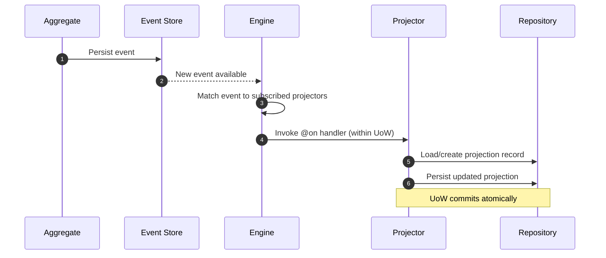

# Projectors

<span class="pathway-tag pathway-tag-cqrs">CQRS</span> <span class="pathway-tag pathway-tag-es">ES</span>

Projectors are specialized event handlers responsible for maintaining
[projections](./projections.md) by listening to domain events and updating
projection data accordingly. They bridge your domain events and read models,
ensuring projections stay synchronized with changes in your domain.

## How Projectors Work

When an aggregate raises an event, the following sequence occurs:



1. An aggregate raises an event and is persisted. The event is written to the
   event store.
2. The Protean Engine's subscription detects the new event.
3. The engine matches the event to all projectors subscribed to that stream
   category.
4. Each matching `@on` handler is invoked within its own Unit of Work.
5. The handler loads or creates the projection record via
   `current_domain.repository_for()`.
6. Changes to the projection are committed atomically when the UoW completes.

If the handler raises an exception, the UoW rolls back and the event may
be retried depending on the subscription configuration.

## Defining a Projector

Projectors are defined using the `Domain.projector` decorator and must be
associated with a specific projection via `projector_for`:

??? example "The elements this example uses"

    ```python
    --8<-- "guides/consume-state/002.py:elements"
    ```

```python hl_lines="1-2"
--8<-- "guides/consume-state/002.py:inventory_projector"
```

You must also specify which events to listen to, via either `aggregates` (a
list of aggregate classes, Protean derives the [stream
categories](../../concepts/async-processing/stream-categories.md)
automatically) or `stream_categories` (a list of stream category names for more fine-grained
control). When both are specified, `stream_categories` takes precedence.

!!! note "Required: `projector_for`"
    Every projector must specify `projector_for`, the projection class it
    maintains. Omitting it raises `IncorrectUsageError`.

## Event Handling with `@on`

Projectors use the `@on` decorator (an alias for `@handle`) to specify which
events they respond to:

```python hl_lines="5 21"
--8<-- "guides/consume-state/002.py:inventory_projector"
```

A single projector can handle multiple events, and multiple projectors can
handle the same event:

??? example "The elements this example uses"

    ```python
    --8<-- "guides/consume-state/projectors/001.py:elements"
    ```

```python
--8<-- "guides/consume-state/projectors/001.py:projectors"
```

## Cross-Aggregate Projections

Projectors can listen to events from multiple aggregates to create
comprehensive views:

??? example "The elements this example uses"

    ```python
    --8<-- "guides/consume-state/projectors/002.py:elements"
    ```

```python
--8<-- "guides/consume-state/projectors/002.py:cross_aggregate"
```

For more granular control, use
[stream categories](../../concepts/async-processing/stream-categories.md)
instead of aggregates. A stream category is qualified with the domain name
(`<domain>::<aggregate>`), so read it from the registered aggregate's
`meta_.stream_category` or write it in full. A bare `"order"` never matches:

```python
--8<-- "guides/consume-state/projectors/002.py:stream_categories"
```

## Idempotency

Projectors should be idempotent to handle duplicate events gracefully:

??? example "The elements this example uses"

    ```python
    --8<-- "guides/consume-state/projectors/003.py:elements"
    ```

```python
--8<-- "guides/consume-state/projectors/003.py:projector"
```

### At-least-once delivery

Event delivery to projectors is at-least-once: after a publish-then-crash the
outbox republishes the message, and a broker can redeliver a message whose
read-model write already committed but was not yet acknowledged. The same event
therefore reaches a projector more than once, carrying the same
`_metadata.headers.id` each time. A projector that accumulates
(`total_reviews += 1`) will double-count unless it is made idempotent.

The safest design is an idempotent upsert, as above: recompute or set the value
rather than increment it, so re-applying the same event is harmless.

### Opting into built-in deduplication

When a projector genuinely cannot be expressed as an upsert, opt into
framework-managed deduplication with `idempotent=True`:

??? example "The elements this example uses"

    ```python
    --8<-- "guides/consume-state/projectors/004.py:elements"
    ```

```python
--8<-- "guides/consume-state/projectors/004.py:projector"
```

Each handler method records a `(message_id, handler)` marker in the same
transaction as its read-model write, so a redelivered event is skipped. This is
atomic (exactly-once) only when the projection is backed by a transactional
provider, since the marker and the read model then share one transaction. For a
cache-backed projection the option has no effect and you must write an
idempotent upsert instead. The marker table is created only for domains that use
the option; run `protean db setup` to create it. See
[ADR-0017](../../adr/0017-consume-side-idempotency-for-projectors.md) for the
design and its boundaries.

Keep three boundaries in mind:

- **Use a relational projection in production**: The exactly-once and
  concurrency guarantees rely on a transactional provider that materializes the
  marker's unique index. The in-memory provider enforces neither, so there the
  option only skips ordinary sequential redeliveries.
- **Adding the option to an existing deployment needs a schema change**: The
  marker table appears only once a projector sets `idempotent=True`; run
  `protean db setup` (or your migration tool) before deploying, or the first
  delivery fails querying a missing table.
- **Markers accumulate**: One row is written per `(message_id, handler)`. Prune
  markers older than your redelivery/recovery window by running `protean
  idempotency cleanup` periodically (from cron); the retention window and batch
  size come from `[consume_idempotency.cleanup]` (default 7 days / 5000 rows).
  Renaming a projector method changes its `handler` identity, orphaning its old
  markers, which the same cleanup eventually removes.

## Transient-failure retries

A projector can retry a handler method *in place* when it fails with a
transient exception, before the message is ever re-delivered or routed to the
DLQ. Set `retries` (and optionally `backoff` / `retry_exceptions`) on the
projector, exactly as on [event handlers](event-handlers.md#transient-failure-retries):

??? example "The elements this example uses"

    ```python
    --8<-- "guides/consume-state/projectors/005.py:elements"
    ```

```python
--8<-- "guides/consume-state/projectors/005.py:projector"
```

Each attempt runs in a fresh Unit of Work, so a partial read-model write from a
failed attempt is rolled back before the next one begins. This is the natural
fix for a concurrency race where a level-triggered event is delivered twice and
both runs take the create path for the same read-model key: the loser hits a
primary-key conflict (a `TransactionError`, which the version/OCC retry does
*not* cover). Adding `TransactionError` to `retry_exceptions` lets the losing
run retry instead of aborting the command under `event_processing=sync`.

The retry re-runs the *same* handler, so convergence is only automatic if the
handler re-checks existence each time, write it as an idempotent upsert
(get-or-create, as under [Idempotency](#idempotency) above) rather than an
unconditional `repo.add(...)`. On the retry the winning run's record is now visible, so the
handler takes the update path and commits cleanly.

The behaviour is identical to event and command handlers: it is opt-in and
disabled unless `retries` is set or `server.transient_retry` is enabled. See
[`server.transient_retry`](../../reference/configuration/index.md) for
domain-wide defaults.

## Event Ordering

Be aware that events may not always arrive in the expected order. Design
projectors to handle out-of-order events:

??? example "The elements this example uses"

    ```python
    --8<-- "guides/consume-state/projectors/006.py:elements"
    ```

```python
--8<-- "guides/consume-state/projectors/006.py:projector"
```

When two events about the same entity must never be applied at the same time,
set `sequential_by` to a field every handled event carries, such as
`sequential_by="product_id"`. On a broker that supports partitioning and a
stream subscription, events in the same stream category that share a value are
then processed one at a time and in publish order. Events from different
categories are not ordered against each other, so a projector over two
aggregates can still apply a `Customer` event and an `Order` event for the same
customer at the same time. See
[Sequential processing](../../reference/server/sequential-by.md).

## Error Handling

Projectors should handle errors gracefully to ensure system resilience:

??? example "The elements this example uses"

    ```python
    --8<-- "guides/consume-state/projectors/007.py:elements"
    ```

```python
--8<-- "guides/consume-state/projectors/007.py:projector"
```

## Handling Deletions

When a projection record should be removed in response to an event, filter
the repository's query for it and call `delete()`. `delete()` returns the
number of records it removed:

??? example "The elements this example uses"

    ```python
    --8<-- "guides/consume-state/projectors/008.py:elements"
    ```

```python
--8<-- "guides/consume-state/projectors/008.py:projector"
```

`delete()` removes only the records the query returns, and a query returns at
most the projection's `limit` (100 by default). When a filter can match more
records than that, call `.limit(None)` before `delete()`.

## Complete Example

Below is a comprehensive example showing projections and projectors working
together to maintain multiple read models from a single aggregate:

```python hl_lines="65-75 77-85 88-117 120-147"
--8<-- "guides/consume-state/002.py:full"
```

This example demonstrates:

- **Multiple Projections**: `ProductInventory` for detailed inventory tracking
  and `ProductCatalog` for simplified browsing
- **Multiple Projectors**: Each projection has its own dedicated projector
- **Event Handling**: Both projectors respond to the same events but update
  different projections
- **Real-time Updates**: Projections are automatically updated when domain
  events occur

## Testing Projectors

### Unit Testing

Test individual projector methods by creating events and calling the methods
directly:

```python
--8<-- "guides/consume-state/projectors/009.py:unit"
```

### Integration Testing

Test the complete flow by raising events from aggregates:

```python
--8<-- "guides/consume-state/projectors/009.py:integration"
```

---

!!! tip "See also"
    **Concept overviews:**

    - [Projections](../../concepts/building-blocks/projections.md): Read-optimized views in CQRS.
    - [Projectors](../../concepts/building-blocks/projectors.md): Specialized handlers that maintain projections.

    **Patterns:**

    - [Design Events for Consumers](../../patterns/design-events-for-consumers.md): Structuring events so projectors can build reliable read models.
    - [Idempotent Event Handlers](../../patterns/idempotent-event-handlers.md): Ensuring projectors handle replayed events correctly.
