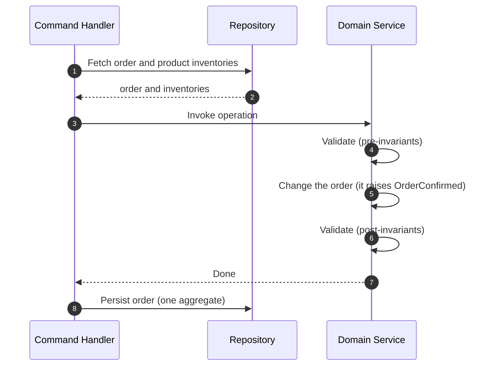

# Domain Services

<span class="pathway-tag pathway-tag-ddd">DDD</span> <span class="pathway-tag pathway-tag-cqrs">CQRS</span> <span class="pathway-tag pathway-tag-es">ES</span>

Some business operations naturally span two or more aggregates. For example,
placing an order requires confirming the order *and* reserving inventory. The
two aggregates must be validated together. If you put this logic in the
`Order` aggregate, it needs to know about `Inventory`; if you put it in the
command handler, business rules leak into the application layer. Domain
services solve this: they encapsulate **cross-aggregate business logic** in the
domain layer, where it belongs.

For background on when and why to use domain services, see
[Domain Services concept](../../concepts/building-blocks/domain-services.md).

!!!warning "Persist one aggregate, let events handle the rest"
    A domain service reads several aggregates to check its invariants, but it
    changes only **one**, the primary aggregate. The command handler invoking
    the service persists that aggregate. The primary aggregate raises an
    event, and an event handler issues a command that changes the other
    aggregate later. This preserves the
    [one aggregate per transaction](../../patterns/one-aggregate-per-transaction.md)
    rule.

## Defining a Domain Service

A Domain Service is defined with the `Domain.domain_service` decorator, and
associated with at least two aggregates with the `part_of` option. The
`part_of` option is **required** and must be a list of **two or more**
aggregates, a domain service that operates on a single aggregate should be
logic on the aggregate itself.

The service methods in a Domain Service can be structured in three flavors:

### 1. Class with class methods

If you don't have any invariants to be managed by the Domain Service, each
method in the Domain Service can be a class method, that receives all
the input necessary for performing the business function. The method checks
the stock itself and returns the order.

```python hl_lines="1-2"
--8<-- "guides/domain-behavior/008.py:98:110"
```

Invoking it is straightforward:

```shell
OrderPlacementService.place_order(order, inventories)
```

!!!note
    Protean does not run a Domain Service's invariants around its class
    methods, so a class-method service should not declare any. If you need
    pre/post invariants, use the instance-method or callable-class flavor.

### 2. Class with instance methods

In this flavor, the Domain Service is instantiated with the aggregates and each
method performs a distinct business function.

```python hl_lines="1-2 9"
--8<-- "guides/domain-behavior/007.py:98:116"
```

You would then instantiate the Domain Service, passing the relevant aggregates
and invoke the methods on the instance.

```shell
service = OrderPlacementService(order, inventories)
service.place_order()
```

### 3. Callable class

If you have a single business function, you can model it as a callable
class:

```python hl_lines="1-2 9"
--8<-- "guides/domain-behavior/006.py:99:117"
```

```shell
service = place_order(order, inventories)
service()
```

### Deciding between flavors

| Criterion | Class methods | Instance methods | Callable class |
|-----------|:---:|:---:|:---:|
| Invariants needed | No | Yes | Yes |
| Multiple operations | Yes | Yes | No (single `__call__`) |
| Simplest for single operation | — | — | Yes |

The decision between instance methods and a callable class boils down to:

1. **How many business functions does the Domain Service have?** If only one,
   a callable class is the simpler shape.
2. **Do you have `pre` invariants that only apply to specific methods?** Then
   construct each method as a separate callable class. If invariants apply to
   all methods, a class with instance methods is preferable.

As your domain model matures, review regularly and decide on the best
way to model the Domain Service.

!!!note
    Invariants only wrap public methods and `__call__`. They skip dunder
    methods (other than `__call__`) and private methods (prefixed with `_`).
    A public method that calls another public method on the same instance
    runs the invariants again around the inner call. An invariant that calls
    a public method fails: that method's wrapper runs the invariant again,
    which calls the method again, until Python's recursion limit stops the
    call. Put helpers in private methods (prefixed with `_`) so
    they are not wrapped.

## Domain Service vs Application Service vs Command Handler

These three constructs coordinate behavior, but at different levels:

| Aspect | Domain Service | Application Service | Command Handler |
|--------|---------------|-------------------|-----------------|
| **Contains business logic** | Yes, cross-aggregate rules | No, orchestration only | No, orchestration only |
| **Operates on** | 2+ aggregates | 1 aggregate | 1 aggregate |
| **Has invariants** | Yes (`@invariant.pre`/`.post`) | No | No |
| **Invoked by** | Command handlers, app services | External callers (API, CLI) | `domain.process(command)` |
| **Returns values** | Optional | Yes (synchronous) | No (fire-and-forget) |

For detailed guidance, see the
[Application Service vs Command Handler](../../patterns/application-service-vs-command-handler.md)
pattern.

## Typical Workflow

Let us consider an example `OrderPlacementService` that checks inventory
stock and confirms an order. The typical workflow of a Domain Service is
below:



The handler loads the necessary aggregates through repositories, invokes the
domain service to perform the cross-aggregate operation, and then persists
only the primary aggregate. `OrderConfirmed` carries the ordered items. An
event handler in the order's cluster reacts to it and issues a command to
each inventory, and the inventory's command handler reserves the stock in
its own transaction.
[Chapter 13 of the tutorial](../getting-started/tutorial/13-domain-services.md)
builds the whole flow, including the event handler and the inventory command.

### Handler Integration Example

```python
@domain.command_handler(part_of=Order)
class OrderCommandHandler:
    @handle(PlaceOrder)
    def handle_place_order(self, command: PlaceOrder):
        order_repo = current_domain.repository_for(Order)
        inventory_repo = current_domain.repository_for(Inventory)

        # Load aggregates
        order = order_repo.get(command.order_id)
        inventories = [
            inventory_repo.get(item.product_id)
            for item in order.items
        ]

        # Invoke the domain service. The invariants run here
        service = place_order(order, inventories)
        service()

        # Persist only the primary aggregate
        order_repo.add(order)
```

## Invariants

Just like Aggregates and Entities, Domain Services can also have invariants.
These invariants validate the state of the aggregates passed to the service
method. Unlike in Aggregates, invariants in Domain Services typically deal
with validations that **span across multiple aggregates**.

`pre` invariants check the state of the aggregates before the service
changes the primary aggregate, while `post` invariants check the state after
the change. When a pre-invariant fails, a `ValidationError` is raised and the
change never happens.

!!!note
   It is a good practice to step back and review the business logic placed in
   the Domain Service now and then. If an invariant does not use multiple
   aggregates, it is likely that it belongs within an aggregate and not in the
   service.

## A Full-Blown Example

```python hl_lines="109-141"
--8<-- "guides/domain-behavior/006.py:full"
```

When an order is placed, `Order` status has to be `CONFIRMED` _and_ the stock
record of each product in `Inventory` has to be reduced.

The service checks the stock and the payment method before anything changes,
and then confirms the order. It does not touch `Inventory`. `OrderConfirmed`
lists each ordered product and quantity, and the inventory reduces its stock
when it handles the command issued for that event. The post invariants check
that the order is confirmed and that the event lists every ordered item, since
an item missing from the event would never be reserved.

A Domain Service fits here because the stock rule needs both aggregates. The
`Order` aggregate cannot see `Inventory`, and a command handler should not
hold business rules.

The stock check reads the inventory as it was loaded. Two orders placed at the
same time can both pass it. The inventory's command handler should check the
stock again before it reserves.

---

!!! tip "See also"
    **Concept overview:** [Domain Services](../../concepts/building-blocks/domain-services.md): When and why to use domain services for cross-aggregate business logic.

    **Related guides:**

    - [Invariants](invariants.md): Business rules enforced on aggregates, entities, and domain services.
    - [Aggregate Mutation](aggregate-mutation.md): How state changes work inside aggregates.
    - [Command Handlers](../change-state/command-handlers.md): Orchestrating state changes from commands.
    - [Application Services](../change-state/application-services.md): Coordinating use cases.

    **Patterns:**

    - [One Aggregate per Transaction](../../patterns/one-aggregate-per-transaction.md): Why domain services persist only one aggregate.
    - [Thin Handlers, Rich Domain](../../patterns/thin-handlers-rich-domain.md): Keeping business logic in the domain, not handlers.
    - [Application Service vs Command Handler](../../patterns/application-service-vs-command-handler.md): Choosing the right orchestration layer.
