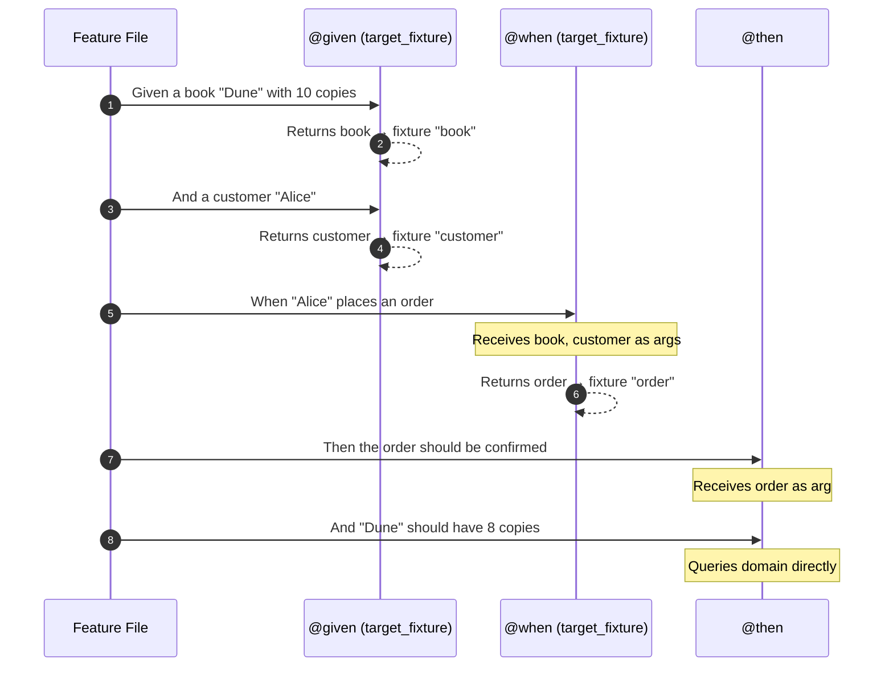

# Application Tests

<span class="pathway-tag pathway-tag-ddd">DDD</span> <span class="pathway-tag pathway-tag-cqrs">CQRS</span> <span class="pathway-tag pathway-tag-es">ES</span>

Application tests validate the **orchestration layer**, commands, command
handlers, event handlers, and application services. They naturally follow a BDD
structure: *Given* a domain state, *When* a command is processed, *Then* verify
the outcomes.

We recommend **[pytest-bdd](https://pytest-bdd.readthedocs.io/)** for writing
these tests. It uses Gherkin feature files to express scenarios in plain
language and maps each step to a Python function, integrating with
pytest fixtures.

Application tests exercise the full processing pipeline (from command dispatch
through handler execution to persistence) using synchronous processing and
in-memory adapters so that assertions are deterministic and no infrastructure
is required.

## Installing pytest-bdd

```shell
pip install pytest-bdd
```

Or with uv:

```shell
uv add --group test pytest-bdd
```

## Project Structure

Organize feature files by domain concept and co-locate step definitions
nearby:

```
tests/
├── conftest.py                  # Root fixtures (domain, context)
├── bdd/
│   ├── conftest.py              # Shared BDD steps and fixtures
│   ├── registration/
│   │   ├── features/
│   │   │   ├── register_user.feature
│   │   │   └── activate_user.feature
│   │   ├── conftest.py          # Registration shared steps
│   │   ├── test_register_user.py
│   │   └── test_activate_user.py
│   ├── ordering/
│   │   ├── features/
│   │   │   ├── place_order.feature
│   │   │   └── cancel_order.feature
│   │   ├── conftest.py          # Ordering shared steps
│   │   ├── test_place_order.py
│   │   └── test_cancel_order.py
│   └── catalog/
│       ├── features/
│       │   └── manage_books.feature
│       ├── conftest.py
│       └── test_manage_books.py
└── unit/
    └── ...                      # Domain model tests (plain pytest)
```

Each domain concept gets its own directory with feature files and step
definitions. Shared steps (like creating common entities) live in
`conftest.py` files at the appropriate level.

## Writing Feature Files

Feature files describe application behavior in Gherkin. A structured, readable
format that maps directly to your domain language.

### A Command Processing Scenario

```gherkin
--8<-- "guides/testing/application-tests/bdd/registration/features/register_user.feature"
```

Use `Background` to express setup steps shared by every scenario in a feature
file. Only `Given` steps belong in a Background.

### An Event Handler Scenario

```gherkin
--8<-- "guides/testing/application-tests/bdd/ordering/features/place_order.feature:feature"
```

### Scenario Outlines for Data-Driven Tests

Use Scenario Outlines when the same flow applies to multiple inputs:

```gherkin
--8<-- "guides/testing/application-tests/bdd/ordering/features/place_order.feature:outline"
```

## Writing Step Definitions

Step definitions are Python functions decorated with `@given`, `@when`, or
`@then`. They connect Gherkin steps to your Protean domain code.

### Binding Scenarios

Use `scenarios()` to bind all scenarios in a feature file to a test module. It
automatically creates a test function for each scenario. You only need to
provide the step definitions:

```python
# fragment
--8<-- "guides/testing/application-tests/bdd/registration/test_register_user.py:steps"
```

### Sharing State with `target_fixture`

Use `target_fixture` to pass data between steps. The return value of the step
becomes a pytest fixture available to all subsequent steps in the same
scenario. The `Given` steps that return the `book` and `customer` fixtures are
shared steps, so they live in `tests/bdd/ordering/conftest.py`, shown under
[Domain-Specific Shared Steps](#domain-specific-shared-steps). The test module
holds the rest:

```python
# fragment
--8<-- "guides/testing/application-tests/bdd/ordering/test_place_order.py:steps"
```

The flow of fixtures through a scenario looks like this:



### Handling Expected Failures

When testing that a command is rejected, capture the exception in the `@when`
step and verify it in `@then`:

```python
# fragment
--8<-- "guides/testing/application-tests/bdd/ordering/test_place_order.py:expected_failure"
```

### Scenario Outline Steps

For Scenario Outlines, use `parsers.parse` with format specifiers to extract
typed values:

```python
# fragment
--8<-- "guides/testing/application-tests/bdd/ordering/test_place_order.py:outline_steps"
```

Common format specifiers for `parsers.parse`:

| Specifier | Type | Example |
|-----------|------|---------|
| `{name}` | `str` (default) | `"Alice"` |
| `{count:d}` | `int` | `42` |
| `{price:f}` | `float` | `19.99` |
| `{word:w}` | word (no spaces) | `ACTIVE` |

## Shared Steps in `conftest.py`

Steps that appear across multiple feature files belong in `conftest.py`.
pytest-bdd discovers step definitions defined there automatically.

### Root-Level Shared Steps

The root `conftest.py` uses `DomainFixture` to initialize the domain and
manage per-test cleanup (see [Fixtures and Patterns](./fixtures-and-patterns.md)
for the full setup):

??? example "The root `conftest.py` these tests run under"

    ```python
    # fragment
    --8<-- "guides/testing/application-tests/conftest.py:conftest"
    ```

The BDD-level `conftest.py` only needs to define shared steps:

```python
# fragment
--8<-- "guides/testing/application-tests/bdd/conftest.py:shared_steps"
```

Since the root `conftest.py` uses `DomainFixture` to call `domain.init()`,
all decorated domain elements (e.g. `@domain.aggregate`,
`@domain.command_handler`) are discovered and wired automatically. No manual
registration is needed.

### Domain-Specific Shared Steps

Steps shared within a single domain concept go in that directory's
`conftest.py`:

```python
# fragment
--8<-- "guides/testing/application-tests/bdd/ordering/conftest.py:ordering_steps"
```

These steps are now available to all test modules under
`tests/bdd/ordering/` without re-definition. The step hierarchy follows
pytest's `conftest.py` discovery:

```
tests/bdd/conftest.py             → steps available everywhere
tests/bdd/ordering/conftest.py    → steps available in ordering/ tests
tests/bdd/registration/conftest.py → steps available in registration/ tests
```

## Testing Application Services

Application services coordinate use cases. Write feature files that describe
the use case, and step definitions that invoke the service:

```gherkin
--8<-- "guides/testing/application-tests/bdd/registration/features/activate_user.feature"
```

```python
# fragment
--8<-- "guides/testing/application-tests/bdd/registration/test_activate_user.py:steps"
```

## Using Tags for Selective Execution

Gherkin tags are converted to pytest markers. Use them to organize and filter
scenarios. The ordering feature above carries `@ordering` and `@smoke` on the
feature, `@happy_path` on the first scenario and `@validation` on the stock
check:

```gherkin
@ordering @smoke
Feature: Place Order
    ...

    @happy_path
    Scenario: Placing an order updates inventory
        ...

    @validation
    Scenario: Cannot order more than available stock
        ...
```

Register the tags as markers in `tests/bdd/conftest.py`, so pytest does not
warn about unknown marks and `--strict-markers` accepts them:

```python
# fragment
--8<-- "guides/testing/application-tests/bdd/conftest.py:markers"
```

Run selectively:

```shell
# Run only ordering scenarios
pytest tests/bdd/ -m ordering

# Run only smoke tests
pytest tests/bdd/ -m smoke

# Run happy path scenarios, skip validation
pytest tests/bdd/ -m "happy_path and not validation"
```

## Tips for Good Feature Files

- **Name features after domain concepts**: "User Registration", not
  "Test UserCommandHandler".
- **Write from the user's perspective**: Describe *what* happens, not
  *how* it's implemented.
- **Keep Background sections short**: Only shared `Given` steps belong there.
- **Use concrete examples**: `"john@example.com"` reads better than abstract
  placeholders in non-outline scenarios.
- **One scenario, one behavior**: Test a single outcome per scenario. Use
  separate scenarios for the happy path and each error case.
- **Reuse steps**: Write steps general enough to appear in multiple
  scenarios. Put them in `conftest.py`.

!!!note
    Setting `command_processing` and `event_processing` to `"sync"` is
    essential for application tests. It ensures commands are handled
    immediately and events are dispatched synchronously, so your `@then` steps
    can verify outcomes deterministically.
