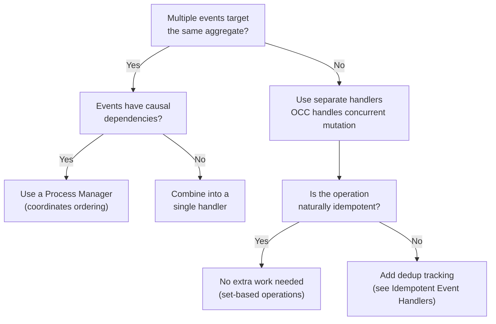

# Designing for Concurrent Event Processing

## The Problem

A developer builds a HubSpot integration with two event handlers. One
handles Client Creation (CC) webhooks, the other handles Client-Contact
Association Changes (CCA). When a user creates a client in HubSpot, both
webhooks fire in rapid succession:

```python
# fragment
@domain.event_handler(part_of=Client)
class ClientCreationHandler(BaseEventHandler):
    @handle(HubspotClientCreated)
    def on_created(self, event: HubspotClientCreated):
        repo = current_domain.repository_for(Client)
        client = Client(hubspot_id=event.hubspot_id, name=event.name)
        repo.add(client)


@domain.event_handler(part_of=Client)
class ClientAssociationHandler(BaseEventHandler):
    @handle(HubspotAssociationChanged)
    def on_association_changed(self, event: HubspotAssociationChanged):
        repo = current_domain.repository_for(Client)
        try:
            client = repo.get_by_hubspot_id(event.hubspot_id)
        except ObjectNotFoundError:
            # Client doesn't exist yet -- create it
            client = Client(hubspot_id=event.hubspot_id)
        client.update_contacts(event.contacts)
        repo.add(client)
```

In production, two workers pick up these events concurrently. The CC
handler begins creating the Client aggregate. Simultaneously, the CCA
handler looks for the Client, doesn't find it yet (CC hasn't committed),
and creates its own copy. Result: duplicate Client records.

This bug is invisible in single-worker testing, code review, and local
development. It only manifests under production concurrency.

The "find or create" pattern in the CCA handler *looks* reasonable. But it is
fundamentally unsafe in a concurrent environment. It assumes that reads and
writes from different handlers are serialized. They are not.

---

## The Four Concurrency Problem Classes

The HubSpot incident is one instance of a broader class of concurrency issues
in event-driven systems. When you know which of the four classes a bug belongs
to, you can pick the right solution.

### Class 1: Concurrent entity creation

Multiple events trigger creation logic for the same aggregate. Without
coordination, duplicates are created.

**Example:** Two webhooks both try to create the same Client. The first
handler's write hasn't committed when the second handler checks for
existence.

### Class 2: Concurrent aggregate mutation

Multiple events modify the same aggregate instance simultaneously.
Without version checking, the last write silently overwrites the first,
losing state changes.

**Example:** Two handlers update the same Order's status concurrently.
One sets it to "paid", the other to "shipped". The last writer wins, and
one status change is lost.

### Class 3: Causal dependency violation

Event B depends on the side effects of event A (e.g., B reads an entity
that A creates). When processed concurrently, B may execute before A's
effects are visible.

**Example:** An `AssociationChanged` event expects a Client from a
`ClientCreated` event. That `ClientCreated` event hasn't been committed yet.

### Class 4: Duplicate processing

The same event is delivered to the same handler twice (at-least-once
delivery). Without idempotency, the handler's side effects are applied
twice.

**Example:** A server crash between event processing and subscription
position update causes the event to be redelivered on restart.

---

## The Pattern

Map each concurrency problem class to the Protean mechanism that solves it.
Don't invent new infrastructure, compose the existing building blocks.

| Problem Class | Primary Solution | Protean Mechanism |
|--------------|-----------------|-------------------|
| Concurrent creation | Process Manager or single handler | `@domain.process_manager` with `correlate` |
| Concurrent mutation | Optimistic concurrency control | Automatic `_version` + `@handle` retry |
| Causal dependency | Process Manager | PM tracks state, buffers until prerequisites met |
| Duplicate processing | Idempotent operations | Set-based design, dedup tracking |

The key insight: **most concurrency bugs in event-driven systems are structural
problems, not infrastructure problems.** They arise from handler topology
(which handlers process which events) rather than from missing framework
features. You remove these structural race conditions when you reorganize the
handlers.

---

## How Protean Already Protects You

### Optimistic Concurrency Control (always-on)

Every aggregate has an automatic `_version` field. The DAO checks this version
on every save. When another transaction has modified the aggregate since the
load, the DAO raises `ExpectedVersionError`. The `@handle` decorator
automatically retries on version conflicts with exponential backoff:

```toml
# domain.toml — these are the defaults
[server.version_retry]
enabled = true
max_retries = 3
base_delay_seconds = 0.05
max_delay_seconds = 1.0
```

So **Protean already protects you from Class 2 (concurrent mutation).** If two
handlers modify the same aggregate concurrently, one succeeds and the other
retries with fresh state. You don't need to opt into this. It is the default
behavior.

For more on classifying version conflicts by business meaning,
see [Optimistic Concurrency as Design Tool](optimistic-concurrency-as-design-tool.md).

### Process Managers (for coordination)

Some events have causal dependencies: one event must be processed before
another can safely execute. For these events, a [Process
Manager](coordinating-long-running-processes.md) is the DDD-correct solution.
The Process Manager correlates related events and tracks what has happened. It
then issues commands in the right order.

### Idempotent handler patterns (for duplicates)

Protean's at-least-once delivery means every event handler must be safe
to run more than once. The
[Idempotent Event Handlers](idempotent-event-handlers.md) pattern
covers three strategies: naturally idempotent operations, deduplication,
and upserts.

### Command idempotency (at the submission boundary)

For commands submitted by external callers, Protean provides a
Redis-backed `IdempotencyStore` that prevents duplicate processing.
See [Command Idempotency](command-idempotency.md).

---

## Applying the Pattern

The HubSpot bug can be fixed in three ways. Choose based on the
complexity of your integration. Solutions A and B use the `Client`
aggregate, its repository and the two webhook events shown with
Solution A.

### Solution A: Combine into a single handler

The simplest fix. If both events target the same aggregate, a single handler
serializes processing naturally. Within one handler's subscription, events are
processed sequentially.

```python
--8<-- "patterns/designing-for-concurrent-event-processing/001.py:model"
--8<-- "patterns/designing-for-concurrent-event-processing/001.py:single_handler"
```

This solution works because a single handler subscription processes events from
the same stream sequentially, in write order. When `HubspotClientCreated` is
written first, it is always processed before `HubspotAssociationChanged`. If
the association event is written first, `get_by_hubspot_id` raises
`ObjectNotFoundError`. When the source can deliver the two events in either
order, use a Process Manager (Solution B).

**Use this solution when** both events target the same aggregate. The handling
logic is simple. No cross-aggregate coordination needed.

### Solution B: Process Manager

When the integration updates multiple aggregates or needs complex state
tracking, a Process Manager provides explicit coordination:

```python
--8<-- "patterns/designing-for-concurrent-event-processing/002.py:commands"
--8<-- "patterns/designing-for-concurrent-event-processing/002.py:process_manager"
```

The Process Manager accepts the two events in either order. The association
event can arrive before the creation event. In that case, the Process Manager
buffers the contacts and applies them once the client exists. Both handlers are
marked `start=True` for this reason. A process manager skips an event when no
instance exists for the event's correlation value and the handler is not a
start handler.

**Use this solution when** events have causal dependencies. Multiple aggregates
are involved. You need explicit state tracking of the integration flow.

### Solution C: Idempotent retry with unique constraints

If the aggregate has a unique business key, the database prevents duplicates.
The handler then skips any work that an earlier delivery already did:

```python
--8<-- "patterns/designing-for-concurrent-event-processing/003.py:aggregate"
--8<-- "patterns/designing-for-concurrent-event-processing/003.py:handler"
```

The unique constraint on `hubspot_id` prevents duplicates at the database
level. A second `Client` with the same `hubspot_id` fails, and its transaction
rolls back. How it fails depends on timing. If the first Client is already
committed, `repo.add` raises a `ValidationError`. With both runs past
`exists_for` and neither committed, the database rejects the second commit. The
unit of work then raises a `TransactionError` that wraps the database's
integrity error. Neither is an `ExpectedVersionError`, so the `@handle` version
retry does not re-run the handler. The retry comes from the subscription
instead: it delivers a failed message again, up to its `max_retries` setting.
On the next delivery, `exists_for` finds the Client and `on_created` returns
without writing. The same redelivery covers an association event that arrives
before the Client exists, where `get_by_hubspot_id` raises
`ObjectNotFoundError` on the first try.

**Use this solution when** the aggregate has a natural unique business key.
Both handlers are idempotent. The flow is simple enough that explicit
coordination is more than it needs.

---

## Decision Tree

When you're unsure which approach to use, follow this sequence:



**Use these quick rules to choose:**

1. **Two handlers, same aggregate?** Combine into one handler. This is
   the simplest and most common fix.
2. **Events must be ordered?** Process Manager. It tracks what has
   happened and what to do next.
3. **Same aggregate modified from different streams?** OCC already
   protects you. Classify the conflict by business meaning.
4. **External system delivers duplicates?** Make the handler idempotent
   using set-based operations or dedup tracking.

---

## Anti-Patterns

### "Find or create" without coordination

```python
# fragment
# UNSAFE: Race condition between find and create
client = repo.find_by_hubspot_id(hubspot_id)
if not client:
    client = Client(hubspot_id=hubspot_id)
    repo.add(client)
```

Between the `find` (returns nothing) and the `add` (creates the entity),
another handler can execute the same sequence. Both handlers see "not
found", both create the entity, and you get duplicates.

**To fix it,** use a Process Manager (Solution B), combine handlers (Solution
A), or rely on unique constraints with retry (Solution C).

### Suppressing `ExpectedVersionError`

```python
# fragment
# WRONG: Silencing the version conflict
try:
    repo.add(aggregate)
except ExpectedVersionError:
    pass  # "It's fine, another handler already did it"
```

An `ExpectedVersionError` is not a harmless error that you can ignore. It tells
you that another transaction modified the same aggregate at the same time. When
you silence it, you may discard an important state change. See [Optimistic
Concurrency as Design Tool](optimistic-concurrency-as-design-tool.md) for how
to classify these conflicts correctly.

### Assuming single-worker deployment

```python
# fragment
# "This can't race because we only run one worker"
```

Single-worker deployment is a scaling decision, not a concurrency guarantee. As
soon as you add a second worker, all unprotected handlers become vulnerable.
Design for concurrency from the start. On a single worker, designing for
concurrency costs nothing, because the patterns are good architecture anyway.
When you scale, the same design prevents production incidents.

### Splitting causally dependent logic across handlers

Suppose event A creates an entity and event B modifies it. Separate handlers
for the two events create a causal dependency, and that dependency requires
explicit coordination. Either combine into one handler or use a Process
Manager. Don't rely on event ordering being preserved across handler
boundaries.

---

## When Not to Use This Pattern

- **When one handler changes one aggregate:** If only one handler modifies an
  aggregate and events arrive from a single stream, there is no concurrency
  risk. Protean's subscription model processes events sequentially within a
  single handler.

- **When a projector builds a read-only projection:** Projectors are naturally
  idempotent when they build read models from events. When you rebuild a
  projection from the same events, you get the same result. Concurrency
  coordination is unnecessary.

- **When side effects are fire-and-forget:** Some handlers send emails, call
  external APIs, or emit notifications. These handlers don't modify aggregate
  state. Make them idempotent, so that they don't send the email twice. They
  don't need OCC or Process Managers.

---

## Summary

| Situation | Solution | Pattern Doc |
|-----------|----------|-------------|
| Two handlers racing on the same aggregate | Combine into one handler | This page |
| Events with causal dependencies | Process Manager | [Coordinating Long-Running Processes](coordinating-long-running-processes.md) |
| Concurrent aggregate mutation | OCC (already built-in) | [Optimistic Concurrency as Design Tool](optimistic-concurrency-as-design-tool.md) |
| Duplicate event delivery | Idempotent handlers | [Idempotent Event Handlers](idempotent-event-handlers.md) |
| External duplicate commands | Command idempotency store | [Command Idempotency](command-idempotency.md) |
| Classifying async failures | Error classification | [Classify Async Processing Errors](classify-async-processing-errors.md) |

Most often, a concurrency bug comes from two handlers racing on the same
aggregate. That bug is a structural problem with a structural solution. Before
you add infrastructure (locks, partitioned streams, framework-level
deduplication), look at the handler topology. The simplest fix is usually to
combine related handlers or introduce a Process Manager.

The solutions on this page (a single handler, a Process Manager, a unique
constraint) leave one specific case uncovered. In that case, a single
high-throughput handler must serialize by an entity key without collapsing
every key onto one worker. For that handler, Protean offers
[`sequential_by`](../reference/server/sequential-by.md) (per-key sequential
processing,
[ADR-0028](../adr/0028-partition-per-key-sequential-processing.md)). Use
`sequential_by` only when the structural options above do not fit.
