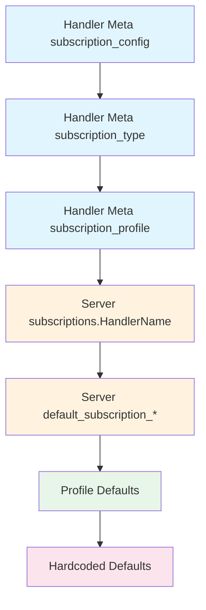

# Subscription Configuration

Protean provides a flexible configuration system for subscriptions that allows
you to configure settings at multiple levels. Configuration follows a priority
hierarchy, with more specific settings overriding general ones.

## Configuration Priority Hierarchy

Configuration is resolved using this priority order (highest to lowest):

1. **Handler Meta `subscription_config`**: Explicit configuration dict on
   handler
2. **Handler Meta `subscription_type`**: Type specified on handler
3. **Handler Meta `subscription_profile`**: Profile specified on handler
4. **Server config handler-specific**: `server.subscriptions.HandlerName`
5. **Server config defaults**: `server.default_subscription_*`
6. **Profile defaults**: Defaults from the resolved profile
7. **Hardcoded defaults**: Built-in fallback values



## Configuration Profiles

Profiles provide pre-configured settings optimized for common scenarios. Using
profiles simplifies configuration while still allowing overrides.

### Available Profiles

| Profile | Type | Description |
|---------|------|-------------|
| `production` | Stream | High throughput with reliability guarantees |
| `fast` | Stream | Low-latency processing |
| `batch` | Stream | High-volume batch processing |
| `debug` | Stream | Development and debugging |
| `projection` | Event Store | Building read models |

### Profile Defaults

#### `production` Profile

Optimized for production workloads with reliability guarantees:

```python
--8<-- "reference/server/configuration/001.py:production"
```

#### `fast` Profile

Optimized for low-latency processing:

```python
--8<-- "reference/server/configuration/001.py:fast"
```

#### `batch` Profile

Optimized for high-throughput batch processing:

```python
--8<-- "reference/server/configuration/001.py:batch"
```

#### `debug` Profile

Optimized for development and debugging:

```python
--8<-- "reference/server/configuration/001.py:debug"
```

#### `projection` Profile

Optimized for building read models:

```python
--8<-- "reference/server/configuration/001.py:projection"
```

### Stream retention defaults {#stream-retention-defaults}

`retention_maxlen` bounds a StreamSubscription's broker stream so processed
messages don't accumulate forever. It is trimmed after each batch. How tight the
bound is depends on the consumer topology, see [Stream
retention](subscription-types.md#stream-retention) for the multi-group and
single-group behavior and their caveats. Each profile carries a default cap:

| Profile | `retention_maxlen` |
| ------- | ------------------ |
| `production` | 100,000 |
| `fast` | 100,000 |
| `batch` | 500,000 |
| `debug` | 1,000 |
| `projection` | none (event-store, no stream to trim) |

The framework-wide default (when no profile applies) is `none`, which leaves
trimming off. Set `retention_maxlen` on a profile, a per-handler config, or a
custom profile to enable it. This is size-based retention only. There is no
time-based TTL.

### Custom Profiles

When the built-in profiles don't match your workload, define your own named
profiles under `[server.profiles.<name>]` in `domain.toml`. A custom profile is a
set of subscription config overrides. Once defined, its name is usable anywhere a
built-in name is: `default_subscription_profile`, a per-handler `profile`, or a
handler's Meta `subscription_profile`.

```toml
--8<-- "reference/server/configuration/custom_profile.toml"
```

```toml
--8<-- "reference/server/configuration/custom_profile_handler.toml"
```

**Inheritance.** With `inherits = "<built-in>"`, the profile starts from that
built-in's defaults and applies your overrides on top. Inheritance is a single
level onto a built-in base only, so a custom profile cannot inherit from another
custom profile (this also means there is no inheritance cycle to fall into).
Without `inherits`, the profile starts from the framework's hardcoded defaults.

**Allowed fields.** A custom profile may set `inherits` plus any of the standard
profile fields: `subscription_type`, `messages_per_tick`, `tick_interval`,
`blocking_timeout_ms`, `max_retries`, `retry_delay_seconds`, `enable_dlq`,
`position_update_interval`, `origin_stream`, `retention_maxlen`,
`circuit_breaker_threshold`, `circuit_breaker_reset_seconds`.

**Validation** is fail-fast, a `ConfigurationError` is raised when the profiles are first
resolved if a custom profile:

- reuses a built-in name (`production`, `fast`, `batch`, `debug`, `projection` are
  reserved),
- sets a field that isn't in the allowed list above, or
- `inherits` from anything other than a built-in profile.

**Precedence is unchanged.** A custom profile name slots into the [priority
hierarchy](#configuration-priority-hierarchy) at whatever level named it, exactly
like a built-in. An explicit field set alongside the profile at the same level still wins
over the profile's default.

**Caveat for `default_subscription_profile`.** A profile named there resolves at
priority 6, which is *below* the server-level defaults at priority 5
(`default_subscription_type`, `messages_per_tick`, `tick_interval`, and the
`[server.stream_subscription]` / `[server.event_store_subscription]` blocks).
When a server-level default sets a field, it overwrites the profile's value.
Protean's built-in configuration sets most of these fields even when
`domain.toml` does not, so `default_subscription_profile` only governs the
fields the server-level defaults leave unset, such as `retention_maxlen`. To
apply a whole profile, name it at a higher level: a per-handler `profile`
(priority 4) or a handler's Meta `subscription_profile` (priority 3). Built-in
and custom profiles behave the same way here.

## Configuration Options Reference

Each default below is the value a handler gets in a domain with no `[server]`
settings and no profile.

### Common Options

| Option | Type | Default | Description |
|--------|------|---------|-------------|
| `subscription_type` | string | `"event_store"` | Subscription type: `"stream"` or `"event_store"` |
| `messages_per_tick` | int | 100 | Messages to process per batch |
| `tick_interval` | int | 0 | Seconds between polling cycles |

### StreamSubscription Options

| Option | Type | Default | Description |
|--------|------|---------|-------------|
| `blocking_timeout_ms` | int | 100 | Longest wait of an idle blocking read, in milliseconds. Must be positive. The Redis broker waits at most 1000 ms per read. A read returns as soon as a message arrives, so the value does not affect latency. With priority lanes on, the Redis broker waits on the primary and the backfill stream at once, and a message on either one ends the wait |
| `max_retries` | int | 3 | Retry attempts before moving to DLQ |
| `retry_delay_seconds` | int | 1 | Delay between retries |
| `enable_dlq` | bool | true | Enable dead letter queue |
| `dlq_retention_hours` | int \| None | inherit | Override `[server.dlq] retention_hours` (default 168) for this subscription's DLQ stream only |
| `dlq_alert_threshold` | int \| None | inherit | Override `[server.dlq] alert_threshold` (default 100) for this subscription's DLQ stream only |
| `circuit_breaker_threshold` | int | 10 | Consecutive handler failures that trip the circuit breaker OPEN |
| `circuit_breaker_reset_seconds` | float | 60 | Seconds an OPEN breaker waits before a single HALF_OPEN probe. Must be > 0 and finite (`inf`/`nan` are rejected) |
| `retention_maxlen` | int | none | Cap the stream at this many entries ([stream retention](subscription-types.md#stream-retention)) |

!!! warning "Known issue: per-handler DLQ overrides have no effect yet"
    The subscription config Protean builds for a handler does not carry
    `dlq_retention_hours` or `dlq_alert_threshold`, so the engine applies the
    `[server.dlq]` values to every handler.

See [Server Hardening → Circuit breaker](./hardening.md#circuit-breaker) for
the state machine, the metric, and the trace events, and
[Tuning subscriptions](../../guides/server/tuning-subscriptions.md) for how to
choose between these options.

### EventStoreSubscription Options

| Option | Type | Default | Description |
|--------|------|---------|-------------|
| `position_update_interval` | int | 10 | Messages between position writes |
| `origin_stream` | string | None | Filter by origin stream category |

## Configuration Methods

### 1. Handler Decorator Options

The examples on this page use this model:

```python
--8<-- "reference/server/configuration/002.py:model"
```

Configure directly on the handler decorator:

```python
--8<-- "reference/server/configuration/002.py:decorator"
```

The options combine with priority:

1. `subscription_config` values override everything
2. `subscription_type` sets the subscription type, even when the profile names
   another type
3. `subscription_profile` provides base defaults

### 2. Domain Configuration File

Configure in `domain.toml`:

```toml
--8<-- "reference/server/configuration/server.toml"
```

### 3. Environment-Specific Configuration

Use environment sections for different deployment environments. Protean picks
the section that matches `PROTEAN_ENV` and merges it into the base `[server]`
settings:

```toml
--8<-- "reference/server/configuration/environments.toml"
```

To use a different profile per environment, name it per handler under
`[server.subscriptions.<Handler>]` in the environment section.
`default_subscription_profile` sits below the server-level defaults, so it
sets few fields (see the [caveat](#custom-profiles)).

## Configuration Examples

### Example 1: Production Event Handler

A handler with production settings and custom batch size:

```python
--8<-- "reference/server/configuration/003.py:production_handler"
```

Resolved configuration:
```python
--8<-- "reference/server/configuration/003.py:production_resolved"
```

### Example 2: Low-Latency Handler

A handler optimized for fast processing:

```python
--8<-- "reference/server/configuration/003.py:fast_handler"
```

Resolved configuration:
```python
--8<-- "reference/server/configuration/003.py:fast_resolved"
```

### Example 3: Projection Handler

A projector using EventStoreSubscription:

```python
--8<-- "reference/server/configuration/003.py:projector"
```

Resolved configuration:
```python
--8<-- "reference/server/configuration/003.py:projector_resolved"
```

### Example 4: Mixed Configuration

Combining domain config with handler config. The handler's server config names
the profile, so the profile sits above the server-level defaults (see the
[caveat](#custom-profiles) on `default_subscription_profile`):

```toml
--8<-- "reference/server/configuration/mixed.toml"
```

```python
--8<-- "reference/server/configuration/004.py:special_handler"
```

Resolved configuration:
```python
--8<-- "reference/server/configuration/004.py:special_resolved"
```

### Example 5: Origin Stream Filtering

Filter events by their origin stream:

```python
--8<-- "reference/server/configuration/003.py:origin_stream"
```

## Configuration Validation

Protean validates configuration and provides helpful error messages:

### Outbox / Subscription Type Conflict

Setting `enable_outbox = true` with `default_subscription_type = "event_store"`
is a configuration error.  The outbox publishes events to Redis Streams, but
event-store subscriptions never read from them, resulting in a broken pipeline.

```
ConfigurationError: Configuration conflict: 'enable_outbox' is True but
'server.default_subscription_type' is 'event_store'. When outbox is enabled,
subscription type must be 'stream' so that subscriptions read from the broker
where the outbox publishes. Either set server.default_subscription_type = 'stream'
or remove enable_outbox.
```

Setting `default_subscription_type = "stream"` automatically enables the outbox
without needing to set `enable_outbox` at all.

### Missing External Broker

Configuring an `external_brokers` entry that doesn't match a registered broker
is a startup error. This configuration is wrong on purpose:
`nonexistent_broker` is not a registered broker.

```toml
[outbox]
external_brokers = ["nonexistent_broker"]
```

```
ValueError: External broker 'nonexistent_broker' configured in
outbox.external_brokers but not found in domain broker configuration
```

### Published Events Without External Brokers

If your domain has events with `published=True` but no `external_brokers`
configured, Protean logs a warning during initialization:

```
WARNING: Domain has published events but no external_brokers configured
in outbox settings. Published events will only be dispatched internally.
```

This is informational, not an error. See
[Dispatching Published Events to External Brokers](../../guides/server/external-event-dispatch.md)
to configure external dispatch.

### Invalid Subscription Type

```python
# fragment
@domain.event_handler(subscription_type="invalid")
```

An unknown subscription type does not raise. The engine logs a warning when it
builds the handler's subscription and falls back to `event_store`:

```
WARNING: Unknown subscription type 'invalid', defaulting to EVENT_STORE
```

Check the log at startup if a handler does not get the subscription you expect.

### Invalid Profile

```python
# fragment
@domain.event_handler(subscription_profile="nonexistent")
```

The engine raises this error when it builds the handler's subscription:

```
ConfigurationError: Unknown subscription profile 'nonexistent'.
Valid profiles: batch, debug, fast, production, projection
```

### Incompatible Options

```python
# fragment
@domain.event_handler(
    subscription_type="event_store",
    subscription_config={"enable_dlq": True}
)
```

Protean logs no error here. `enable_dlq` controls the broker-side dead letter
stream, which only a stream subscription has, so the engine turns `enable_dlq`
off for an event store subscription and keeps the rest of the configuration.
An event store subscription records failed positions in its own failed-position
stream and retries them in a recovery pass, described in
[Error Handling](../../guides/server/error-handling.md#eventstoresubscription).

## Configuration guidance

### 1. Use Profiles as a Starting Point

Start with a profile and override specific options:

```python
# fragment
@domain.event_handler(
    part_of=Order,
    subscription_profile="production",
    subscription_config={
        "messages_per_tick": 50,  # Adjust based on your workload
    }
)
```

### 2. Configure at the Right Level

- **Handler level**: Handler-specific tuning
- **Server config**: Domain-wide defaults
- **Environment config**: Environment-specific overrides

### 3. Use `debug` Profile in Development

Name the `debug` profile on the handlers you are working on:

```toml
--8<-- "reference/server/configuration/development.toml"
```

`default_subscription_profile = "debug"` sets far less. Protean's built-in
server-level defaults set most fields the `debug` profile sets, and the
resolver applies them after the profile, as the [caveat](#custom-profiles)
explains. Only `retention_maxlen` comes from the profile, because the built-in
`[server.stream_subscription]` block does not set it. So with
`default_subscription_type = "stream"`, a stream subscription whose handler
names no profile caps its stream at 1000 entries. A handler that names its own
profile keeps that profile's cap.

### 4. Monitor and Adjust

Start with conservative settings and adjust based on monitoring:

```python
# fragment
# Start conservative
subscription_config={"messages_per_tick": 10}

# Increase after monitoring shows capacity
subscription_config={"messages_per_tick": 100}
```

### 5. Enable DLQ in Production

Always enable DLQ for production workloads to capture failed messages:

```python
# fragment
subscription_config={"enable_dlq": True}
```

## Related pages

- [Subscription Types](subscription-types.md): Subscription
  types
- [Running the Server](../../guides/server/index.md): CLI options and deployment
